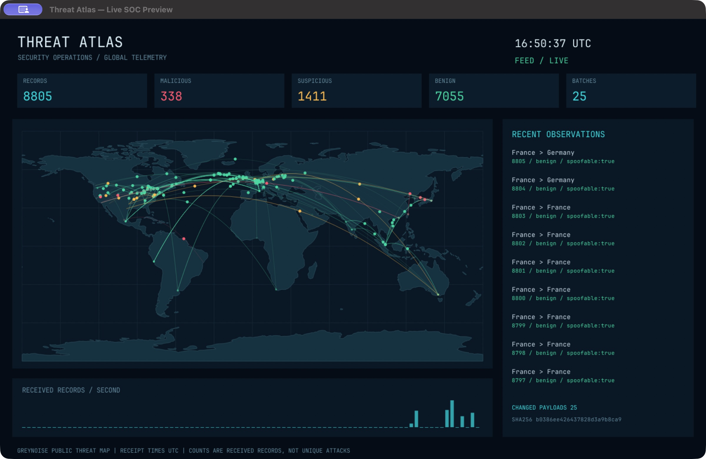

# Threat Atlas SOC

Native Rust SOC screensaver for macOS 12+ and Windows 10/11 x64. It draws a world
map, animated routes, receipt counters and a recent-observations log from the
GreyNoise public threat-map feed. No embedded website, cookies, login or API key.



*Captured macOS preview with live GreyNoise telemetry. Counters represent received records.*

## Install

**Windows:** use `ThreatAtlas-0.3.0-x64.msi`. The per-user installer copies the
screensaver to `%LOCALAPPDATA%\ThreatAtlas` and adds a **Threat Atlas SOC** Start
Menu folder. Open **Set up Threat Atlas**, choose the saver, set the wait time,
and Apply. **Preview Threat Atlas** opens a normal window. No manual copying or
administrator account is required. Before uninstalling via Settings → Apps,
select another screen saver. The installer preserves idle, lock and password
settings. See [Windows setup](installer/INSTALL.txt).

**macOS:** extract the macOS ZIP, double-click `ThreatAtlasSOC.saver`, and install
for your user account. Quit and reopen System Settings, then open Wallpaper →
Screen Saver → Custom → Other → Show All and select **Threat Atlas SOC**. The ZIP
also contains **Threat Atlas SOC.app**, a windowed preview. The universal bundle
supports Intel and Apple Silicon. Keep bundles zipped when syncing through cloud
storage: Finder metadata on unpacked bundles can invalidate ad-hoc signatures.

Local builds are unsigned on Windows and ad-hoc signed on macOS. Public releases
need trusted signing; see [signing instructions](docs/SIGNING.md). Do not disable
OS security protections to run an untrusted download.

## Data and privacy

The only runtime network destination is GreyNoise's public threat-map WebSocket,
`wss://threat-map-api.greynoise.io/ws`, using certificate-validated TLS. GreyNoise
receives your IP address and normal connection metadata. No analytics or observed
IP-address scanning is added. See [GreyNoise's privacy policy](https://www.greynoise.io/privacy-policy).
This independent project is not endorsed by GreyNoise.

The feed supplies no event IDs or event timestamps. Times are local UTC receipt
times; counters are received records, not unique attacks. Routes are a bounded
visual sample and expire after six seconds. LIVE means a valid record arrived
within ten seconds. Stale/offline feeds are labelled and reconnect with backoff.
This viewer cannot verify provider event age or authenticity. Availability and
schema may change. Review the provider's terms before redistributing or using
its feed commercially; the MIT license covers this project's code, not telemetry.

## Build and check

Install current stable Rust. macOS requires Xcode Command Line Tools; Windows
requires MSVC C++ Build Tools and the Windows SDK.

```sh
cargo fmt --all --check
cargo test --workspace --locked
cargo clippy --workspace --all-targets --locked -- -D warnings
cargo install cargo-audit --version 0.22.2 --locked
cargo audit --deny warnings
bash scripts/build-macos.sh --universal
```

Windows:

```powershell
rustup target add x86_64-pc-windows-msvc
powershell -File scripts/build-windows.ps1
```

MSI after building `dist/ThreatAtlas.scr`: install `msitools`/`wixl` on Linux or
macOS, then `bash scripts/build-msi.sh`. The MSI contains an embedded cabinet.
`./scripts/test-msi.ps1` tests installation/uninstallation on a disposable Windows
account. Do not run that test on an account with an existing Threat Atlas install.

GitHub Actions builds both platforms, produces an MSI, runs quality checks and
runs an MSI lifecycle test on a Windows runner. Workflows use read-only repository
permissions and pinned action commits. Release signing is deliberately separate
from untrusted pull-request builds. Enable GitHub private vulnerability reporting
and branch protection after creating the repository.

`cargo run --release --locked -p threat-atlas-core --example verify_live -- audit-run`
checks the external feed for increasing records and changed payloads, producing
frames and JSON. It needs network access and is not an offline CI test.

[Quality review and limitations](docs/QUALITY.md) · [Security policy](SECURITY.md)

## License

Source: MIT. Bundled JetBrains Mono: SIL OFL; see `assets/FONT-LICENSE.txt`.
Natural Earth land outlines are public domain. See `assets/ATTRIBUTION.md`.
Third-party Rust crates retain their own licenses. Provider content is not MIT.
